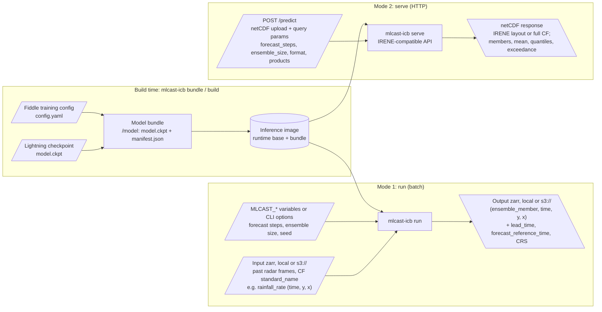

# mlcast-inference-container-builder

Turns a trained [mlcast](https://github.com/mlcast-community/mlcast) nowcasting model
(checkpoint + training config) into a ready-to-run inference container image. One image
offers two modes: `run` (batch, zarr in/out on S3) and `serve` (an HTTP server compatible
with the IRENE API).



Status: working prototype, not yet released. Model bundles (`bundle`, `info`), the batch
mode (`run`), the HTTP server (`serve`) and the image builds (`build-base`, `build`) all
work and are tested, including in Docker and on the real IRENE checkpoint. Base images
are published to ghcr.io from the first version tag on; until then, build one locally
first (see [Building images](#building-images)).

- [PLAN.md](PLAN.md) — feasibility, design and build order.
- [CHANGELOG.md](CHANGELOG.md) — what changed, release by release.
- [src/mlcast_icb/upstream/README.md](src/mlcast_icb/upstream/README.md) — code written to
  move into mlcast, one proposed PR at a time.

## Usage

One command, `mlcast-icb` (or `python -m mlcast_icb`). `bundle`, `info`, `build` and
`build-base` run at build time, and `run` and `serve` run inside the image.

### `bundle`: package a trained model

```sh
mlcast-icb bundle --checkpoint model.ckpt --config config.yaml --timestep PT5M \
    --out bundle/ --name irene --model-version 1.0
```

This writes a **model bundle**, the directory an image carries at `/model`:

- `model.ckpt` holds the weights and the module's hyperparameters, with the inference spec
  embedded. Optimizer and scheduler state are dropped, so no training YAML is needed at
  run time.
- `manifest.json` holds the spec, the sha256 of `model.ckpt` and of the source checkpoint,
  the builder and mlcast versions, the creation time, and the optional `--name` and
  `--model-version`.

`--config` is needed unless the checkpoint already embeds a spec, as converted checkpoints
do. Training configs do not record the time between steps, so pass `--timestep`. Before
the manifest is written, the bundle is reloaded strictly and runs one forward pass on CPU.
A model that fails either check is never bundled, and the command exits 6.

### `info`: show what a bundle is

```sh
mlcast-icb info bundle/            # prints manifest.json; the default is $MLCAST_MODEL_DIR, then /model
mlcast-icb info bundle/ --verify   # also checks the checksum and loads the model
```

### Configuring `run` and `serve`

`run` and `serve` follow the convention of DMI's MLWP inference containers (as in
[mlwp-inference-container-anna](https://github.com/dmidk/mlwp-inference-container-anna)),
with the prefix `MLCAST`. Every command line option `--some-option` can also be set with
the environment variable `MLCAST_SOME_OPTION`. An option on the command line wins over its
variable, which wins over the default:

```sh
mlcast-icb run --input-zarr s3://radar/composite.zarr --output-zarr /data/forecast.zarr --device cuda
# or, equivalently
MLCAST_INPUT_ZARR=s3://radar/composite.zarr MLCAST_OUTPUT_ZARR=/data/forecast.zarr MLCAST_DEVICE=cuda mlcast-icb run
```

- Flags take `true`/`false` (also `1`/`0`, `yes`/`no`) from their variable.
- An empty variable counts as unset.
- A set `MLCAST_*` variable that matches no option is an error (exit 2), so a misspelling
  cannot go unnoticed:
  `unknown environment variable(s) MLCAST_ENSEMBLE_SIZ (did you mean MLCAST_ENSEMBLE_SIZE?)`.
- `run` and `serve` share one image, and so one environment: a variable of the other
  command is ignored (and logged at `DEBUG`), not an error. Only names that are an option
  of neither command fail.
- The developer commands (`bundle`, `info`, `build`, `build-base`) are configured by their
  options only. They read no `MLCAST_*` variable, except that `info` defaults to
  `$MLCAST_MODEL_DIR`, and do not check them.
- Every value is checked before anything is loaded, and all problems are reported
  together, in a single error (exit 2), each named as it was given: by its variable or by
  its option.
- The log starts with the version, then the effective configuration: every option with
  its variable name, value and where the value came from (`cli`, `env` or `default`).
  Credentials are never shown; a `*_STORAGE_OPTIONS` value is logged with its secrets
  masked.
- `mlcast-icb run --help` and `mlcast-icb serve --help` list every option with its
  variable.

The mapping between options and variables is done by
[`src/mlcast_icb/envargs.py`](src/mlcast_icb/envargs.py), copied from ANNA's
container. It only uses the standard library and has nothing mlcast-specific.

### `run`: batch forecast, zarr in and out (Mode 1)

`run` reads the zarr store `--input-zarr` and writes the forecast to `--output-zarr`.

| Option | Environment variable | Default | |
| --- | --- | --- | --- |
| `--input-zarr` | `MLCAST_INPUT_ZARR` | (required) | Input store URI: a local path, `s3://…` or `gs://…` |
| `--output-zarr` | `MLCAST_OUTPUT_ZARR` | (required) | Output store URI. Any existing store there is replaced |
| `--model-dir` | `MLCAST_MODEL_DIR` | `/model` | The model bundle |
| `--forecast-reference-time` | `MLCAST_FORECAST_REFERENCE_TIME` | last time in the input | The last input time, in ISO 8601 (`2026-05-01T12:00Z`). A time without a zone is read as UTC |
| `--forecast-steps` | `MLCAST_FORECAST_STEPS` | the model's | Number of steps to forecast |
| `--ensemble-size` | `MLCAST_ENSEMBLE_SIZE` | the model's | Number of ensemble members |
| `--seed` | `MLCAST_SEED` | | Seed for the ensemble noise. With a seed, runs are reproducible |
| `--device` | `MLCAST_DEVICE` | `auto` (`cuda` in GPU images) | `auto`, `cuda` or `cpu`. With `cuda`, a run without a visible GPU exits 4 instead of falling back to CPU |
| `--zarr-format` | `MLCAST_ZARR_FORMAT` | `auto` | `auto` (same as the input), `2` or `3` |
| `--log-level` | `MLCAST_LOG_LEVEL` | `INFO` | loguru level |
| `--input-aws-profile` | `MLCAST_INPUT_AWS_PROFILE` | (AWS config) | AWS profile for the input store |
| `--input-s3-endpoint-url` | `MLCAST_INPUT_S3_ENDPOINT_URL` | (AWS config) | S3 endpoint for the input store |
| `--input-s3-anon` | `MLCAST_INPUT_S3_ANON` | (auto) | `true`: unsigned requests to the input store; `false`: signed. Unset: anonymous unless credentials are found (`--no-input-s3-anon` on the command line for `false`) |
| `--input-storage-options` | `MLCAST_INPUT_STORAGE_OPTIONS` | | Further fsspec options for the input store, a JSON object merged last |
| `--output-aws-profile` | `MLCAST_OUTPUT_AWS_PROFILE` | (AWS config) | AWS profile for the output store |
| `--output-s3-endpoint-url` | `MLCAST_OUTPUT_S3_ENDPOINT_URL` | (AWS config) | S3 endpoint for the output store |
| `--output-s3-anon` | `MLCAST_OUTPUT_S3_ANON` | (auto) | As `--input-s3-anon`, for the output store |
| `--output-storage-options` | `MLCAST_OUTPUT_STORAGE_OPTIONS` | | As `--input-storage-options`, for the output store |

The run reads only the variables whose `standard_name` the model uses (plus their grid
mapping), and only the model's input window, ending at the reference time. It writes
one variable per input variable, with dimensions `(ensemble_member, time, y, x)`. The
`time` coordinate holds valid times, alongside `lead_time` and `forecast_reference_time`
coordinates. The model's name, version and sha256 are recorded in the store's attributes.

After the effective configuration, the log shows the storage options each store resolved
to (credentials masked) and the bundle's manifest. At the end it reports timings, and peak
GPU memory on CUDA.

| Exit code | Meaning |
| --- | --- |
| 0 | Success |
| 1 | Anything unexpected (traceback logged) |
| 2 | Configuration error (including an unknown option or `MLCAST_*` variable) |
| 3 | Input error: the store is missing, or does not match what the model expects |
| 4 | Device error: `--device cuda` with no usable GPU |
| 5 | Storage error: a store could not be reached, read or written |
| 6 | Model error: the bundle is missing or corrupt (rebuild the image) |

#### S3 endpoints and credentials

The input and output stores are configured separately, so they can be on different S3
hosts with different credentials:

- `--{input,output}-aws-profile` sets the profile (from `~/.aws`) for that store. It also
  takes precedence over `AWS_ACCESS_KEY_ID`/`AWS_SECRET_ACCESS_KEY`/`AWS_SESSION_TOKEN` in
  the environment, which botocore then ignores for that store.
- `--{input,output}-s3-endpoint-url` sets the endpoint for that store. It is usually
  better carried by the profile's `endpoint_url` in `~/.aws/config`.
- Unset, a store uses the usual AWS configuration: `AWS_PROFILE`, the `AWS_*` keys, an IAM
  role, `AWS_ENDPOINT_URL` / `AWS_ENDPOINT_URL_S3`, or an `endpoint_url` in the profile.
  Credentials have no options of their own: they come from the environment, a profile or
  a role.
- Access is anonymous unless credentials are found: a profile (`--*-aws-profile` or
  `AWS_PROFILE`), `AWS_*` keys, role credentials, or credentials in `--*-storage-options`.
  Reading a public bucket then just works. `--*-s3-anon` decides explicitly, e.g.
  `MLCAST_INPUT_S3_ANON=false` to sign with the `default` profile of `~/.aws/credentials`.
- `--*-storage-options` reaches any other fsspec/s3fs option (`requester_pays`,
  `config_kwargs`, a `gs://` project, …) and wins over the options above.
- A store that cannot be reached exits 5, with a hint naming the `MLCAST_INPUT_*` or
  `MLCAST_OUTPUT_*` variables that configure it.

For example, reading from one S3 host and writing to another, each with its own profile in
`~/.aws`:

```ini
# ~/.aws/config                       # ~/.aws/credentials
[profile radar-reader]                [radar-reader]
endpoint_url = https://s3.example.org aws_access_key_id = …
                                      aws_secret_access_key = …
[profile forecast-writer]             [forecast-writer]
endpoint_url = https://s3.dmi.dk      aws_access_key_id = …
                                      aws_secret_access_key = …
```

```sh
MLCAST_INPUT_ZARR=s3://radar/composite.zarr \
MLCAST_INPUT_AWS_PROFILE=radar-reader \
MLCAST_OUTPUT_ZARR=s3://nowcasts/latest.zarr \
MLCAST_OUTPUT_AWS_PROFILE=forecast-writer \
    mlcast-icb run

# in the container, which runs as the user `model` (uid 1000, home /home/model)
docker run --rm -v ~/.aws:/home/model/.aws:ro \
    -e MLCAST_INPUT_ZARR=s3://radar/composite.zarr -e MLCAST_INPUT_AWS_PROFILE=radar-reader \
    -e MLCAST_OUTPUT_ZARR=s3://nowcasts/latest.zarr -e MLCAST_OUTPUT_AWS_PROFILE=forecast-writer \
    IMAGE run
```

Without a config file, give each store its endpoint and the keys in the standard variables:
`-e AWS_ACCESS_KEY_ID=… -e AWS_SECRET_ACCESS_KEY=… -e MLCAST_INPUT_S3_ENDPOINT_URL=https://s3.example.org
-e MLCAST_OUTPUT_S3_ENDPOINT_URL=https://s3.dmi.dk`. Keys in the environment apply to every
store that has no profile of its own.

### `serve`: HTTP server, netCDF in and out (Mode 2)

`serve` answers forecasts over HTTP. Its API is a superset of the
[IRENE](https://huggingface.co/it4lia/irene) server, so IRENE clients work unchanged. It
needs the `serve` extra (FastAPI, uvicorn, prometheus-client), and it is configured like
`run`:

```sh
mlcast-icb serve --model-dir bundle/ --device cpu   # OpenAPI docs at http://localhost:8000/docs
```

| Option | Environment variable | Default | |
| --- | --- | --- | --- |
| `--model-dir` | `MLCAST_MODEL_DIR` | `/model` | The model bundle |
| `--device` | `MLCAST_DEVICE` | `auto` (`cuda` in GPU images) | `auto`, `cuda` or `cpu`, as for `run` |
| `--host` | `MLCAST_HOST` | `0.0.0.0` | Address to bind |
| `--port` | `MLCAST_PORT` | `8000` | Port to bind |
| `--max-upload-mb` | `MLCAST_MAX_UPLOAD_MB` | `100` | Largest upload; larger ones get 413 |
| `--max-queue` | `MLCAST_MAX_QUEUE` | `2` | Predictions that may wait while one runs; more get 429 with `Retry-After` |
| `--request-timeout` | `MLCAST_REQUEST_TIMEOUT` | | Seconds a prediction may wait for the model before it gets 503 with `Retry-After`. Unset waits indefinitely |
| `--max-forecast-steps` | `MLCAST_MAX_FORECAST_STEPS` | `48` | Upper limit of `forecast_steps` (IRENE: 48) |
| `--max-ensemble-size` | `MLCAST_MAX_ENSEMBLE_SIZE` | `10` | Upper limit of `ensemble_size` (IRENE: 10) |
| `--log-level` | `MLCAST_LOG_LEVEL` | `INFO` | loguru level |

Startup works as it does for `run`. The log starts with the version, then the effective
configuration, then the bundle. A configuration error exits 2, an unusable device exits 4
and a broken bundle exits 6, all before the port is bound. A port that cannot be bound
exits 1. After the port is bound, one warm-up forecast runs in the background.

| Endpoint | Purpose |
| --- | --- |
| `GET /health` | IRENE's health check: `{"status": "ok", "model_loaded": true}` |
| `GET /healthz` | Liveness: 200 whenever the process answers |
| `GET /readyz` | Readiness: 200 once the model is loaded and warmed up, 503 before that or if the warm-up failed |
| `GET /model/info` | IRENE's fields (`architecture`, `num_blocks`, `forecast_steps`, `ensemble_size`, …), plus the bundle's name, version, sha256, spec and the server's limits |
| `GET /metrics` | Prometheus: requests by route and status, request latency, inference duration, queue depth, predictions in progress, readiness, model info |
| `POST`/`PUT /predict` | Forecast. Send the netCDF (netCDF4 or netCDF3) as the multipart field `file`, or as the raw body with `Content-Type: application/x-netcdf` or `application/octet-stream` |

`/predict` takes these query parameters:

| Parameter | Default | Meaning |
| --- | --- | --- |
| `variable` | `RR` | Input variable. If it is not given: with `format=irene`, `RR` is tried first, then the variable with the model's `standard_name`; with `format=cf`, the order is reversed |
| `forecast_steps` | the model's | 1 to `--max-forecast-steps` |
| `ensemble_size` | the model's | 1 to `--max-ensemble-size` |
| `format` | `irene` | `irene` gives IRENE's bare layout. `cf` gives the CF-complete forecast |
| `products` | `members` | `format=cf` only. A comma-separated subset of `members`, `mean`, `quantiles` and `exceedance` |
| `quantiles` | `0.1,0.5,0.9` | Levels for `products=quantiles` |
| `thresholds` | `0.5,1,5` | Thresholds, in the variable's units (mm/h for rain rate), for `products=exceedance` |
| `dtype` | `float32` | `float16` stores the data as CF-packed `int16` (`scale_factor`/`add_offset`). This halves the size, and every CF reader can read it |
| `complevel` | `4` | zlib level, 0 to 9 |
| `seed` | unset | Seed for the ensemble noise. A seeded request is reproducible |
| `mask` | `false` | When true, the forecast is NaN wherever the input had no valid value in any input step. Without it, such points are forecast as no rain, as in IRENE |

The response is `predictions.nc` (`application/x-netcdf`). The headers `X-Elapsed-Seconds`,
`X-Model-Sha256`, `X-Model-Name`, `X-Model-Version`, `X-Mlcast-Version`,
`X-Builder-Version` and `X-Request-Id` come with it. `X-Request-Id` echoes the client's
own ID or a generated one, and it appears in every log line of the request. The same
provenance is stored in the file's global attributes.

- **`format=irene`** writes
  `precipitation_forecast(ensemble_member, forecast_step, y, x)` in mm/h, zlib-compressed
  and without coordinates, with IRENE's global attributes. The input is read the way
  IRENE reads it: dimensions by position as (time, y, x), values as mm/h whatever their
  `units` attribute says, and time values ignored.
- **`format=cf`** uses the input's `standard_name`, `units` (mm/h and kg m-2 s-1 are both
  accepted), datetime coordinate, CF axes, grid mapping and auxiliary coordinates where
  they exist. It also checks that input times are spaced by the model's timestep. The
  output has the input's x/y and grid mapping, valid `time`, `lead_time` and
  `forecast_reference_time`, and `standard_name`/`units` on every variable. For a variable
  `v`, the products are `v` (members), `v_mean`, `v_quantile(quantile, time, y, x)` and
  `v_exceedance_probability(threshold, time, y, x)`. Bare IRENE-style inputs work too. If
  the input has no datetime coordinate, the times are assumed to end at the request time,
  and the file's `comment` attribute says so.

The model uses the last `input_steps` times of the input. With fewer times, the request
gets 422. IRENE itself accepts 2 or more. Bad parameters and unusable inputs get 422
(Inf values, a missing variable, a non-3-D variable, a first dimension that is not time,
or a file that is not netCDF). A raw body with any other content type gets 415.

```sh
# IRENE-compatible: the same request IRENE's clients send
curl -F file=@sample_data.nc "localhost:8000/predict?variable=RR&forecast_steps=12&ensemble_size=10" -o predictions.nc

# CF output with the ensemble mean and exceedance probabilities, packed to 16 bits, reproducible
curl -X PUT -H "Content-Type: application/x-netcdf" --data-binary @radar.nc \
    "localhost:8000/predict?format=cf&products=mean,exceedance&thresholds=1,5,10&dtype=float16&seed=42" -o forecast.nc
```

Inference runs in a worker thread. A single lock serialises the model, which keeps seeded
forecasts reproducible, and the health and metrics endpoints answer even while a forecast
runs. Run one uvicorn worker per GPU, which is what `serve` starts.

## Building images

A model image is two parts:

- **The runtime base image.** It holds Python, torch, the pinned mlcast and this package,
  but no model. There is one per builder release and torch variant, named
  `ghcr.io/mlcast-community/mlcast-inference-runtime:<builder version>-<variant>`, for
  example `…:0.1.0-gpu-cu126`. A `+` in a development version becomes `-` in the tag.
- **One layer with the model bundle at `/model`.** `mlcast-icb build` adds it.

A bundle is only guaranteed to load in the runtime of the builder that made it, so
`build` defaults to the base image of its own version.

### `build`: checkpoint in, image out

```sh
mlcast-icb build --checkpoint model.ckpt --config config.yaml --timestep PT5M \
    --name irene --model-version 1.0 --tag registry.example.com/nowcast/irene:1.0 \
    [--torch gpu-cu126 | --base-image IMAGE] [--platform linux/amd64] [--push]
mlcast-icb build --bundle bundle/ --tag …   # from an existing bundle instead
```

`build` first makes the bundle in a temporary build context, exactly as `bundle` does. If
the strict reload or the forward pass fails, it stops before Docker is involved (exit 6).
It then runs `docker build` on [`docker/Dockerfile.model`](docker/Dockerfile.model):
`FROM` the base image, plus `COPY bundle/ /model/`. The manifest's identity becomes image
labels: `io.github.mlcast-community.model.{name,version,sha256,created,mlcast-version,builder-version}`,
plus the OCI `title`, `version` and `base.name`. The base image's labels (builder, mlcast
version and commit, torch variant) are inherited.

- `--torch` picks the base image variant: `cpu` (the default), `gpu-cu126`, `gpu-cu128`
  or `gpu-cu130`.
- `--push` builds and pushes with `docker buildx build --push`. Log in to the registry
  first.
- Without a docker command or a reachable daemon, `build` exits 2 and suggests
  `--context-only`.
- If the base image is already in the local image store and its mlcast version label
  differs from the bundle's, `build` logs a warning: the model may not load in that
  runtime. A base image that is not local is not pulled just for this check.

**Without a Docker daemon** (kaniko, buildah, a locked-down CI runner), use
`--context-only DIR`. It writes the context (`Dockerfile.model` and `bundle/`) and prints
the build command, `--build-arg`s included, then stops. Any builder that takes `--build-arg`
can build it:

```sh
mlcast-icb build --checkpoint model.ckpt --config config.yaml --tag reg/irene:1.0 --context-only ctx/
# docker build --file ctx/Dockerfile.model --tag reg/irene:1.0 --build-arg BASE_IMAGE=… ctx/
```

Run the image with an explicit subcommand. There is no default command, so a container
started without one prints the usage and exits 2:

```sh
docker run --rm IMAGE info --verify
docker run --rm -v "$PWD/data:/data" -e MLCAST_INPUT_ZARR=/data/in.zarr -e MLCAST_OUTPUT_ZARR=/data/out.zarr IMAGE run
docker run --rm -v "$PWD/data:/data" IMAGE run --input-zarr /data/in.zarr --output-zarr /data/out.zarr   # the same
docker run --rm -p 8000:8000 IMAGE serve
```

Containers run as the user `model` (uid 1000, home `/home/model`), so a mounted output
directory must be writable by it, and `~/.aws` is mounted at `/home/model/.aws`. The image
sets `MLCAST_MODEL_DIR=/model`. GPU variants set `MLCAST_DEVICE=cuda`, so a GPU image
started without a GPU exits 4. Pass `--gpus all`, or `-e MLCAST_DEVICE=cpu` (or
`run --device cpu`) to run it on CPU anyway.

There is no Docker `HEALTHCHECK`. Kubernetes ignores it, so probe `serve` with
liveness/readiness probes on `/healthz` and `/readyz` instead.

### `build-base`: the runtime base image

Until base images are published, build the one you need locally, from a clone of this
repository:

```sh
uv run --extra cpu --extra dev mlcast-icb build-base --torch cpu   # tags it as `build` expects
uv run --extra cpu --extra dev mlcast-icb build-base --torch gpu-cu126 --platform linux/amd64
uv run --extra cpu --extra dev mlcast-icb build-base --dry-run     # just print the docker command
```

This is `docker build -f docker/Dockerfile.base --build-arg TORCH_EXTRA=<variant> .` with
the label build args added. The build:

- Installs every dependency exactly as `uv.lock` pins it, with the `remote` and `serve`
  extras.
- Puts torch and its CUDA wheels in their own layer, verified by hash. A lock update
  that leaves torch alone does not rebuild that layer.
- Builds mlcast from the commit the lock pins, and fails if the result is not the
  locked version.
- Takes the builder's version from the git tag (hatch-vcs).

`--expected-version v0.1.0` fails the build unless the package builds as exactly that
version, so a release cannot ship under the wrong version.

| Variant | OS base | torch build |
| --- | --- | --- |
| `cpu` | `debian:trixie-slim` | CPU |
| `gpu-cu126` | `nvidia/cuda:12.6.3-base-ubuntu24.04` | CUDA 12.6 |
| `gpu-cu128` | `nvidia/cuda:12.8.1-base-ubuntu24.04` | CUDA 12.8 |
| `gpu-cu130` | `nvidia/cuda:13.0.3-base-ubuntu24.04` | CUDA 13.0 |

Each CUDA base version matches the `cuda-toolkit` the lock pins for that extra. The
`-base` image's `NVIDIA_REQUIRE_CUDA` check therefore asks the host driver for exactly
what torch was built against. The CUDA libraries themselves come from torch's
`nvidia-*` wheels, which is why the image uses `-base` rather than `-runtime`.

Each builder release corresponds to one mlcast version, and so does each base image; see
[Pinned mlcast version](#pinned-mlcast-version).

`pytest --run-docker` (or `ICB_TEST_DOCKER=1`) also runs the Docker tests. They build
the cpu base image and a tiny model image on it, then check `info`, the labels and the
missing-subcommand exit, and that `run` in the container matches a local run. The base
build takes about 4 minutes cold and seconds from cache. With
`ICB_TEST_BASE_IMAGE=<image>` they use that already built cpu base image instead,
as CI does. (The tests' own switches start with `ICB_TEST_`, never `MLCAST_`: the
application would reject an unknown `MLCAST_*` variable.)

## Development

```sh
uv sync --extra cpu --extra remote --extra serve --extra dev
uv run --extra cpu --extra remote --extra serve --extra dev pytest
uv run --extra cpu --extra remote --extra serve --extra dev ruff check .
uv run --extra cpu --extra remote --extra serve --extra dev ruff format --check .
```

The `serve` extra is needed for `tests/test_serve.py`, `remote` for the S3 tests.

torch is chosen by exactly one of the `cpu`, `gpu-cu126`, `gpu-cu128` and `gpu-cu130`
extras, mirroring mlcast's own extras. Pass the same `--extra` flags to `uv run`, or it
re-syncs without them.

## CI

GitHub Actions, in [`.github/workflows/`](.github/workflows):

| Workflow / job | When | What |
| --- | --- | --- |
| `ci.yml` lint | every PR and push to `main` | `uv lock --check`, then ruff (the locked version) `check` and `format --check` |
| `ci.yml` test | every PR and push to `main` | `uv sync --locked` with the `cpu`, `remote`, `serve` and `dev` extras, then `pytest`, on Python 3.11 and the container's Python (read from `docker/Dockerfile.base`) |
| `ci.yml` irene | push to `main`, weekly, on demand | the `--run-irene` tests on the real IRENE checkpoint; the Hugging Face cache is kept between runs, keyed on IRENE's revision |
| `ci.yml` docker | PRs and pushes to `main` that change `docker/`, `src/`, `pyproject.toml`, `uv.lock` or the Docker tests; weekly; on demand | builds the cpu base image with buildx (cached in GitHub Actions), then runs the `--run-docker` tests on it; nothing is pushed |
| `publish-image.yml` | a version tag `vX.Y.Z…` | builds the base image for every torch variant, smoke-tests it, and pushes it to `ghcr.io/mlcast-community/mlcast-inference-runtime` as `<version>-<variant>`, plus `<major>.<minor>-<variant>` and `latest-<variant>` for final releases (cpu for linux/amd64 and linux/arm64, GPU variants for linux/amd64) |
| `dependabot-changelog.yml` | Dependabot PRs | records the update in [CHANGELOG.md](CHANGELOG.md) |

Dependabot ([`.github/dependabot.yml`](.github/dependabot.yml)) proposes updates to the
GitHub Actions, `uv.lock` (except mlcast, which is bumped by hand with a release) and the
CUDA base images (patch releases only).

To release, tag in canonical PEP 440 form (`v0.1.0`, `v0.2.0rc1`) and push the tag. The
build fails unless the package builds as exactly the tag's version.

## Pinned mlcast version

Each builder release pins one exact mlcast commit (`[tool.uv.sources]` in
`pyproject.toml`, resolved in `uv.lock`). Bumping mlcast means cutting a new builder
release.

| Builder version | mlcast commit |
| --- | --- |
| unreleased | [`5edce07`](https://github.com/mlcast-community/mlcast/commit/5edce0756410ecdd963b2a5ba85e3afc6a0a532b) (upstream `main`) |
